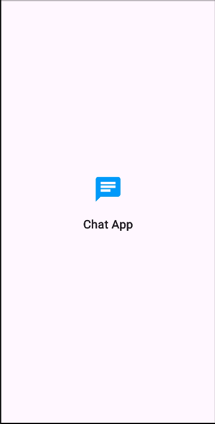
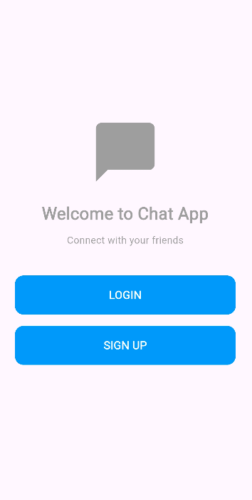
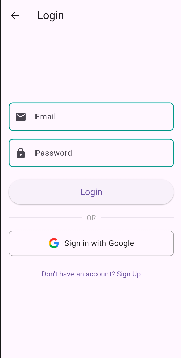
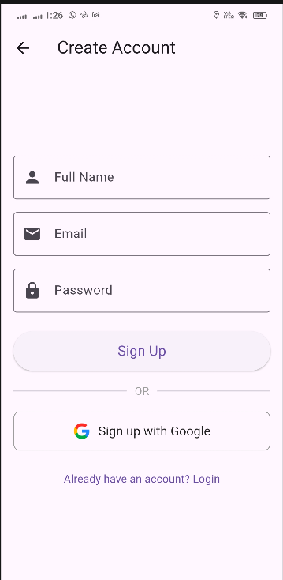
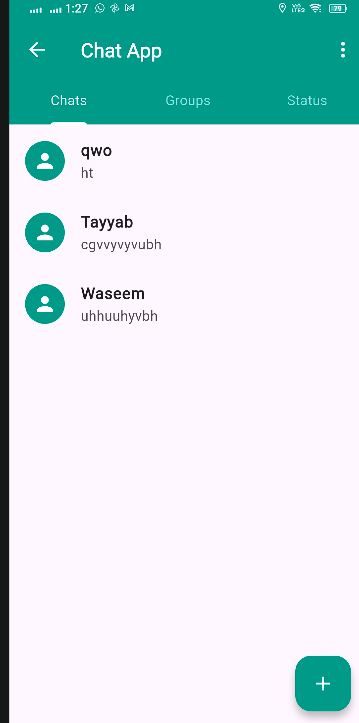
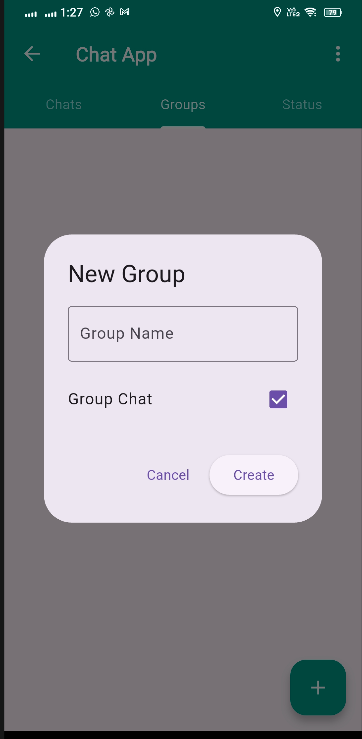
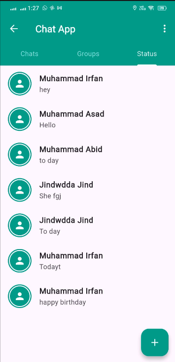
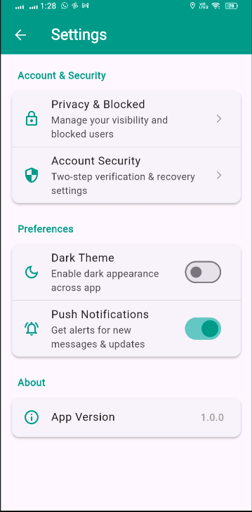

# 📱 ChatApp - Real-Time Flutter & Firebase Messaging Application

A modern, full-featured real-time Chat and Messaging application built with **Flutter** and powered by **Firebase** (Authentication, Cloud Firestore, Google Sign-In). Designed with a clean WhatsApp/Telegram-style interface featuring 1-on-1 chats, group messaging, status updates, and user profile management.

---

## 📸 App Screenshots

| Splash Screen | Welcome Screen | Login Screen |
|:---:|:---:|:---:|
|  |  |  |

| Create Account | Chats Screen | Create Group Dialog |
|:---:|:---:|:---:|
|  |  |  |

| Status / Stories | App Settings |
|:---:|:---:|
|  |  |

---

## 🌟 Key Features Overview

### 1. 🔐 Authentication & Security
- **Email & Password Authentication**: Seamless registration and login powered by Firebase Auth with real-time form validation and comprehensive error handling.
- **Google Sign-In**: Single-tap authentication using Google Sign-In on Android, iOS, and Web.
- **Persistent User Sessions**: Automatic session restore on app launch; users stay logged in securely without having to re-authenticate.
- **Smart Splash Screen**: Automatically checks auth status (`FirebaseAuth.instance.currentUser`) and routes directly to `HomeScreen` or `WelcomeScreen`.
- **Secure Log Out**: One-click complete sign-out clearing local session cache and Firebase tokens.

### 2. 💬 Real-Time 1-on-1 Chatting
- **Instant Messaging**: Powered by Cloud Firestore real-time snapshots (`StreamBuilder`) for sub-second message delivery.
- **Message Bubbles**: Distinctive chat bubble styling—Teal aligned to the right for the sender, and soft grey aligned to the left for recipient.
- **Last Message & Timestamp**: Chat list previews the latest message and timestamp dynamically.
- **Auto-Scroll**: Messages automatically scroll down to the newest incoming or outgoing message.
- **Contact Renaming**: Rename or save custom contact names directly from the chat screen with persistent Firestore sync.

### 3. 👥 Group Messaging & Management
- **Dedicated Groups Tab**: Easily toggle between private conversations and group channels.
- **Create Groups**: Create custom group chats with unique group titles in seconds.
- **Add Members**: Add participants to groups from your contacts or ongoing chats.
- **Group Info Modal**: View complete group details including:
  - Total member count
  - Admin/Creator badges
  - Member initials and display names
- **Group Message Badges**: Each message bubble in a group clearly labels the sender's name for effortless readability.

### 4. ⭕ Status / Story Updates
- **WhatsApp-Style Status Tab**: Share quick text updates and thoughts with contacts.
- **Status Rings**: Circular profile badges with teal borders signaling new updates.
- **Interactive Status Viewer**: Tap on any contact's status to view their post in an overlay dialog.

### 5. 👤 Profile & Customization
- **Profile Picture**: Select and upload avatars directly from the **Camera** or **Gallery** using `image_picker`.
- **Base64 Local Image Cache**: Instant loading of profile pictures across app restarts.
- **Edit Display Name**: Easily modify profile display name, which synchronizes with Firebase Auth and Firestore.
- **Remove Avatar**: Reset to default placeholder avatar with a single tap.

### 6. ⚙️ Settings & Preferences
- **Dark Theme Toggle**: Local preference toggle saved via `SharedPreferences`.
- **Notification Settings**: Enable/disable push notifications toggle.
- **Account & Security Hub**: Navigation shortcuts for privacy, security, and app version info.

---

## 🛠️ Tech Stack & Dependencies

| Technology | Purpose |
| :--- | :--- |
| **Flutter SDK (v3.8+)** | Cross-platform UI development for Android, iOS, and Web |
| **Firebase Core** | Core Firebase initialization & configuration |
| **Firebase Auth** | User authentication (Email/Password & OAuth) |
| **Cloud Firestore** | Real-time NoSQL cloud database for chats, messages, and statuses |
| **Google Sign-In** | Google OAuth authentication |
| **Shared Preferences** | Local persistent key-value storage for settings & cached user data |
| **Image Picker** | Device camera and gallery image selection |

---

## 📁 Project Structure

```text
lib/
├── firebase_options.dart   # Generated Firebase configuration
├── main.dart               # App entry point, Firebase & Google Sign-In setup
├── splash_screen.dart      # Splash branding and auth-state routing
├── welcome_screen.dart     # Landing screen with Login / Sign Up actions
├── login_screen.dart       # Email/Password & Google Sign-In screen
├── signup_screen.dart      # New user registration screen
├── home_screen.dart        # Main dashboard with Chats, Groups, & Status tabs
├── chat_screen.dart        # Real-time chat room (1-on-1 and Group chats)
├── profile_screen.dart     # User profile, avatar management, and logout
└── settings_screen.dart    # Dark mode & notification preference toggles
```

---

## 🚀 Getting Started & Installation

### Prerequisites
- [Flutter SDK](https://docs.flutter.dev/get-started/install) installed and configured on your machine.
- An active [Firebase Project](https://console.firebase.google.com/).

### Installation Steps

1. **Clone the repository:**
   ```bash
   git clone https://github.com/irfanonline5811-afk/chatapp.git
   cd chatapp
   ```

2. **Install Flutter dependencies:**
   ```bash
   flutter pub get
   ```

3. **Firebase Configuration:**
   - Ensure your `google-services.json` (for Android) is placed inside `android/app/`.
   - For web/iOS, configure with FlutterFire CLI:
     ```bash
     flutterfire configure
     ```

4. **Run the Application:**
   ```bash
   flutter run
   ```

---

## 📄 License
This project is open-source and available under the [MIT License](LICENSE).
